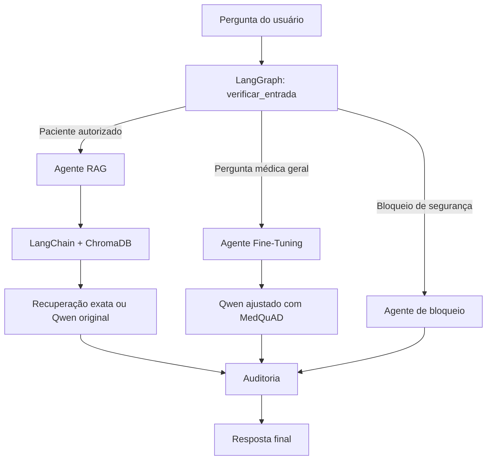

# Tech Challenge — Fase 3: Assistente Médico com LLM

## Sobre o projeto

Este projeto apresenta um protótipo acadêmico de assistente médico desenvolvido com **Fine-Tuning, RAG (Retrieval-Augmented Generation), LangChain, ChromaDB e LangGraph**.

O sistema possui dois agentes:

- **Fine-Tuning:** responde perguntas médicas gerais com o modelo Qwen2.5-0.5B-Instruct ajustado com o dataset público MedQuAD.
- **RAG:** consulta prontuários sintéticos, recuperando exames e observações clínicas de pacientes identificados e autorizados.

O LangGraph coordena as solicitações e registra o caminho percorrido em um arquivo de auditoria.

> **Aviso:** projeto exclusivamente acadêmico. As respostas não são clinicamente validadas e não devem orientar decisões médicas reais.

## Tecnologias utilizadas

- Python e Google Colab
- PyTorch e Hugging Face Transformers
- Qwen2.5-0.5B-Instruct
- MedQuAD
- LangChain e LangGraph
- ChromaDB
- Sentence Transformers

## Fine-Tuning

O treinamento foi realizado utilizando o dataset [MedQuAD](https://github.com/abachaa/MedQuAD), formado por perguntas e respostas sobre saúde.

Foi utilizado **Full Fine-Tuning**, atualizando os pesos do modelo Qwen, com uma época de treinamento em GPU Tesla T4.

### Resultados do treinamento

| Métrica                           |            Resultado |
| ---------------------------------- | -------------------: |
| Exemplos de treinamento elegíveis |               11.391 |
| Exemplos de validação elegíveis |                1.439 |
| Épocas                            |                    1 |
| Etapas de otimização             |                1.424 |
| Tempo de treinamento               | Aproximadamente 1h02 |
| Train loss                         |              1,28149 |
| Eval loss final                    |              1,21580 |

O modelo ajustado foi exportado como `qwen-medquad-full-ft-v2.zip`.

**Pesos do modelo:** [Acessar o modelo ajustado](https://drive.google.com/file/d/12bqqNCePiaR-8DenRnhBT2g25g6HH5vi/view?usp=sharing)

As métricas demonstram a execução do treinamento, mas não representam acurácia clínica.

## Dados sintéticos

Foram criados 1.000 pacientes fictícios, contendo dados cadastrais, observações clínicas e exames simulados.

Os registros estão disponíveis em `data/processed/patients_vector_v1.json`.

Os dados são convertidos em **3.000 documentos vetoriais**, indexados no ChromaDB por meio de embeddings multilíngues.

Não foram utilizados prontuários reais. Os PDFs de protocolos estudados em experimentos anteriores não integram a versão final do agente RAG.

## Arquitetura do assistente

O LangGraph determina qual caminho será executado, conforme o tipo de solicitação.

### Consulta de prontuários

O agente reconhece o identificador ou o nome completo do paciente. Quando necessário, utiliza a idade para diferenciar registros com nomes repetidos.

A autorização demonstrativa é verificada antes da recuperação dos documentos.

Exemplo de pergunta:

**Quais exames estão pendentes para a paciente Marina Almeida Costa, 53 anos?**

Resposta esperada para o caso sintético utilizado nos testes:

`EX-0001-01: Hemograma | Status: PENDENTE`

### Perguntas médicas gerais

Perguntas sem referência a um prontuário são encaminhadas ao modelo ajustado com MedQuAD.

Exemplo: `What is diabetes mellitus?`

As respostas são sinalizadas como não validadas clinicamente.

## Como executar no Google Colab

O notebook principal está na pasta `notebooks/`.

### Pré-requisitos

- Conta Google para utilizar o Google Colab e o Drive.
- Ambiente Python com as bibliotecas do projeto.
- Acesso ao arquivo ZIP do modelo ajustado, disponível no link acima.

### Preparação

1. Abra o notebook no Google Colab.
2. Baixe o arquivo `qwen-medquad-full-ft-v2.zip`.
3. No seu Google Drive, crie a pasta `TechChallenge3/models/`.
4. Coloque o ZIP nessa pasta, sem descompactá-lo.
5. Execute as células indicadas abaixo.

### Sequência de execução do assistente

| Células | Finalidade                                   |
| -------- | -------------------------------------------- |
| 44–45   | Preparação do ambiente e dados sintéticos |
| 46–47   | Indexação e recuperação no ChromaDB      |
| 48       | Agente RAG                                   |
| 50       | LangGraph e auditoria                        |
| 52–53   | Restauração e carregamento do Fine-Tuning  |
| 54       | Integração do modelo ajustado ao LangGraph |
| 55       | Validação funcional                        |

As células anteriores à 44 documentam o desenvolvimento e o treinamento original. **Não é necessário repetir o treinamento para executar o assistente.**

As células 49 e 51 correspondem a verificações intermediárias e não são necessárias para a execução final.

Na primeira execução, o ChromaDB será construído a partir dos pacientes sintéticos. Em execuções posteriores, o índice persistido poderá ser reutilizado.

## Testes e resultados

Foram validados funcionalmente os seguintes cenários:

- Consulta de exames pelo ID do paciente.
- Consulta pelo nome completo e idade.
- Bloqueio de identificação ambígua.
- Tratamento de paciente não identificado.
- Bloqueio de acesso não autorizado.
- Bloqueio de solicitação direta de prescrição.
- Execução do modelo com Fine-Tuning.

Os caminhos percorridos pelo LangGraph são registrados em `auditoria_langgraph.jsonl`.

## Limitações

O sistema utiliza dados sintéticos, permissões demonstrativas e guardrails baseados em regras.

O modelo ajustado pode gerar informações imprecisas ou incorretas. Foi observada uma resposta com associação conceitual inadequada entre diabetes mellitus e síndrome metabólica.

O projeto não possui autenticação hospitalar real nem validação clínica sistemática.

## Documentação técnica

Consulte [o relatório técnico](docs/relatorio_tecnico.md) para informações adicionais sobre o treinamento, a arquitetura, os resultados e suas limitações.
