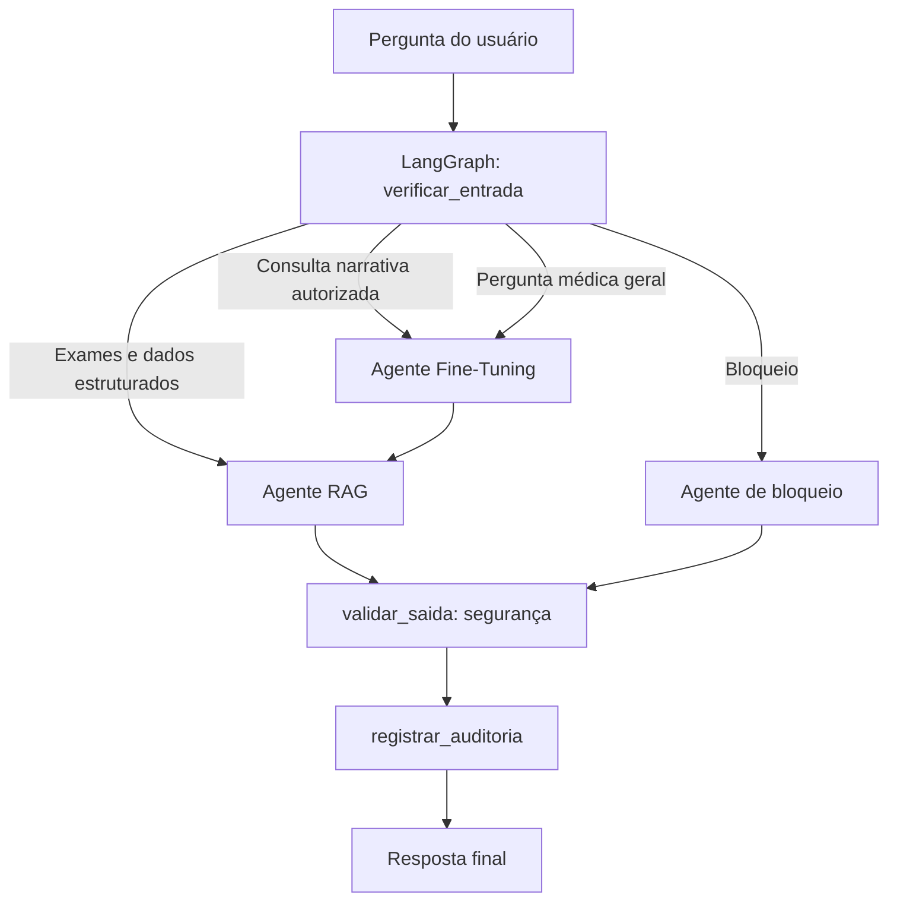

# Tech Challenge — Fase 3: Assistente Médico com LLM

## Sobre o projeto

Este projeto apresenta um protótipo acadêmico de assistente médico desenvolvido com **Fine-Tuning, RAG (Retrieval-Augmented Generation), LangChain, ChromaDB e LangGraph**.

O sistema possui dois agentes:

- **Fine-Tuning:** responde perguntas médicas gerais com o modelo Qwen2.5-0.5B-Instruct ajustado com o dataset público MedQuAD.
- **RAG:** consulta prontuários sintéticos, recuperando exames e observações clínicas de pacientes identificados e autorizados.

O LangGraph coordena dois percursos principais: **RAG direto** para consultas estruturadas e **Fine-Tuning → RAG** para consultas narrativas autorizadas. Perguntas médicas gerais utilizam o modelo ajustado sem consultar prontuários. Cada solicitação passa por verificações demonstrativas de segurança e auditoria.

> **Aviso:** projeto exclusivamente acadêmico. As respostas não são clinicamente validadas e não devem orientar decisões médicas reais.

## Tecnologias utilizadas

- Python e Google Colab
- PyTorch e Hugging Face Transformers
- Qwen2.5-0.5B-Instruct
- MedQuAD
- LangChain e LangGraph
- ChromaDB
- Sentence Transformers

## Fine-Tuning

O treinamento foi realizado utilizando o dataset [MedQuAD](https://github.com/abachaa/MedQuAD), formado por perguntas e respostas sobre saúde.

Foi utilizado **Full Fine-Tuning**, atualizando os pesos do modelo Qwen, com uma época de treinamento em GPU Tesla T4.

### Resultados do treinamento

| Métrica                           |            Resultado |
| ---------------------------------- | -------------------: |
| Exemplos de treinamento elegíveis |               11.391 |
| Exemplos de validação elegíveis |                1.439 |
| Épocas                            |                    1 |
| Etapas de otimização             |                1.424 |
| Tempo de treinamento               | Aproximadamente 1h02 |
| Train loss                         |              1,28149 |
| Eval loss final                    |              1,21580 |

O modelo ajustado foi exportado como `qwen-medquad-full-ft-v2.zip`.

**Pesos do modelo:** [Acessar o modelo ajustado](https://drive.google.com/file/d/12bqqNCePiaR-8DenRnhBT2g25g6HH5vi/view?usp=sharing)

As métricas demonstram a execução do treinamento, mas não representam acurácia clínica.

## Dados sintéticos

Foram criados 1.000 pacientes fictícios, contendo dados cadastrais, observações clínicas e exames simulados.

Os registros sintéticos são armazenados em `TechChallenge3/data/synthetic/patients_vector_v1.json` no Google Drive.

Os dados são convertidos em **3.000 documentos vetoriais**, indexados no ChromaDB por meio de embeddings multilíngues.

Não foram utilizados prontuários reais. Os PDFs de protocolos estudados em experimentos anteriores não integram a versão final do agente RAG.

## Arquitetura do assistente

O LangGraph seleciona a rota conforme a pergunta, a identificação do paciente e a autorização demonstrativa:

- **RAG direto (`rag`):** consultas estruturadas, como exames pendentes, recuperam os dados do paciente autorizado sem executar o Fine-Tuning.
- **Fine-Tuning → RAG (`fine_tuning_rag`):** consultas narrativas, como sintomas, passam pelo modelo ajustado e depois pelo agente RAG. O Fine-Tuning gera um rascunho auxiliar; a resposta final é fundamentada nos registros recuperados. Para sintomas e observações, o RAG transcreve a nota original, sem incorporar o rascunho.
- **Perguntas médicas gerais (`fine_tuning`):** usam o modelo ajustado. O fluxo passa pelo nó RAG, mas **não consulta prontuários** quando não há paciente identificado.
- **Bloqueio (`bloqueio`):** solicitações proibidas, identificação ambígua e acessos não autorizados são interrompidos antes da consulta aos dados.

A autorização é verificada na entrada, **antes do acesso ao ChromaDB**, e as respostas passam por uma verificação de saída. A auditoria registra rota, status, fontes contabilizadas e nós executados, sem registrar o conteúdo das perguntas ou respostas.

### Consulta de prontuários

O agente reconhece o identificador ou o nome completo do paciente. Quando necessário, utiliza a idade para diferenciar registros com nomes repetidos.

A autorização demonstrativa é verificada antes da recuperação dos documentos.

**Exemplo — RAG direto:**

`Quais exames estão pendentes para a paciente Marina Almeida Costa, 53 anos?`

Resultado do teste:

`EX-0001-01: Hemograma | Status: PENDENTE`

Rota: `rag` · Status: `recuperacao_exata`

**Exemplo — Fine-Tuning seguido de RAG:**

`Quais sintomas estão registrados para a paciente Marina Almeida Costa, 53 anos?`

Resultado do teste:

> Observações clínicas registradas (transcrição):
> - Paciente relata episódios de cefaleia e tontura.

Rota: `fine_tuning_rag` · Status: `recuperacao_textual`

Nesse caso, o Qwen ajustado é executado primeiro, mas a transcrição final preserva o conteúdo da nota sintética recuperada. **Isso não comprova precisão clínica do modelo ajustado.** Outras perguntas narrativas ainda podem receber geração experimental do Qwen original, sinalizada como não validada.

### Perguntas médicas gerais

Perguntas sem referência a um prontuário são encaminhadas ao modelo ajustado com MedQuAD.

Exemplo: `What is diabetes mellitus?`

O nó RAG é atravessado sem recuperar dados de pacientes. As respostas são sinalizadas como não validadas clinicamente.

## Como executar no Google Colab

O notebook principal está na pasta `notebooks/`.

### Pré-requisitos

- Conta Google para utilizar o Google Colab e o Drive.
- Ambiente Python com as bibliotecas do projeto.
- Acesso ao arquivo ZIP do modelo ajustado, disponível no link acima.

### Preparação

1. Abra o notebook no Google Colab.
2. Baixe o arquivo `qwen-medquad-full-ft-v2.zip`.
3. No seu Google Drive, crie a pasta `TechChallenge3/models/`.
4. Coloque o ZIP nessa pasta, sem descompactá-lo.
5. Execute as células indicadas abaixo.

### Organização do notebook

O notebook está dividido em **seis seções principais**. Os nomes abaixo correspondem aos títulos exibidos no índice lateral do Colab:

| Seção | Título | Conteúdo |
| --- | --- | --- |
| **1** | **Ambiente e carregamento do MedQuAD** | GPU, dependências, Google Drive e dataset. |
| **2** | **Preparação dos dados para o Fine-Tuning** | Qwen base, formatação, tokenização e validação. |
| **3** | **Full Fine-Tuning definitivo e exportação** | Configuração, treinamento já realizado, métricas e ZIP. |
| **4** | **Prontuários sintéticos e RAG** | Base fictícia, ChromaDB, recuperação e agente RAG. |
| **5** | **LangGraph e integração dos agentes** | Roteamento, restauração e carregamento do modelo ajustado, integração. |
| **6** | **Validação e demonstração** | Testes funcionais, auditoria e perguntas interativas. |

### Sequência de execução do assistente (sessão nova)

Execute as células de código **de cima para baixo** nas seções abaixo, sem usar a opção "Executar tudo":

1. **Seção 4 — Prontuários sintéticos e RAG:** execute todos os blocos, de **Preparação do ambiente do assistente médico** até **Agente RAG com Qwen**.
2. **Seção 5 — LangGraph e integração dos agentes:** execute todos os blocos, de **Orquestração dos agentes com LangGraph** até **Integração do modelo Fine-Tuning ao LangGraph**.
3. **Seção 6 — Validação e demonstração:** execute **Validação final do assistente médico** e, para demonstrar consultas, **Teste realizando o input no terminal**.

As seções **1 e 2** documentam a preparação original do treinamento; não são necessárias para restaurar o assistente já treinado. A seção **3** contém o treinamento histórico: **não reexecute o bloco _Execução do Full Fine-Tuning ampliado_**, pois ele chama `trainer_v2.train()`. Para restaurar o modelo no assistente, utilize o ZIP na seção 5, sem treinar novamente.

Na primeira execução, o ChromaDB será construído a partir dos pacientes sintéticos. Em execuções posteriores, o índice persistido poderá ser reutilizado.

## Testes e resultados

A execução do bloco **Validação final do assistente médico**, na **seção 6 — Validação e demonstração**, confirmou oito cenários funcionais:

- Consulta de exames pelo ID do paciente via RAG direto.
- Consulta de exames pelo nome completo e idade via RAG direto.
- Consulta de sintomas pela sequência Fine-Tuning → RAG, com transcrição da nota original.
- Bloqueio de identificação ambígua.
- Tratamento de paciente não identificado.
- Bloqueio de acesso não autorizado.
- Bloqueio de solicitação direta de prescrição.
- Execução do modelo ajustado para uma pergunta médica geral.

Foram confirmados **oito registros de auditoria** em `auditoria_langgraph.jsonl`, incluindo as rotas e os nós executados. Esses resultados validam o comportamento dos cenários testados, **não a exatidão clínica das respostas**.

## Limitações

O sistema utiliza dados sintéticos, permissões demonstrativas e guardrails baseados em regras.

O modelo ajustado pode gerar informações imprecisas ou incorretas. Foi observada uma resposta com associação conceitual inadequada entre diabetes mellitus e síndrome metabólica. Em um teste narrativo anterior, a geração também distorceu o termo "cefaleia"; por isso, as perguntas de sintomas agora transcrevem as notas recuperadas em vez de reformulá-las.

A execução do Fine-Tuning antes do RAG demonstra a integração dos agentes, mas, nas respostas por transcrição, o rascunho do Fine-Tuning não contribui com fatos clínicos para a resposta final.

O projeto não possui autenticação hospitalar real nem validação clínica sistemática.

## Documentação técnica

Consulte [o relatório técnico](docs/relatorio_tecnico.md) para informações adicionais sobre o treinamento, a arquitetura, os resultados e suas limitações.
