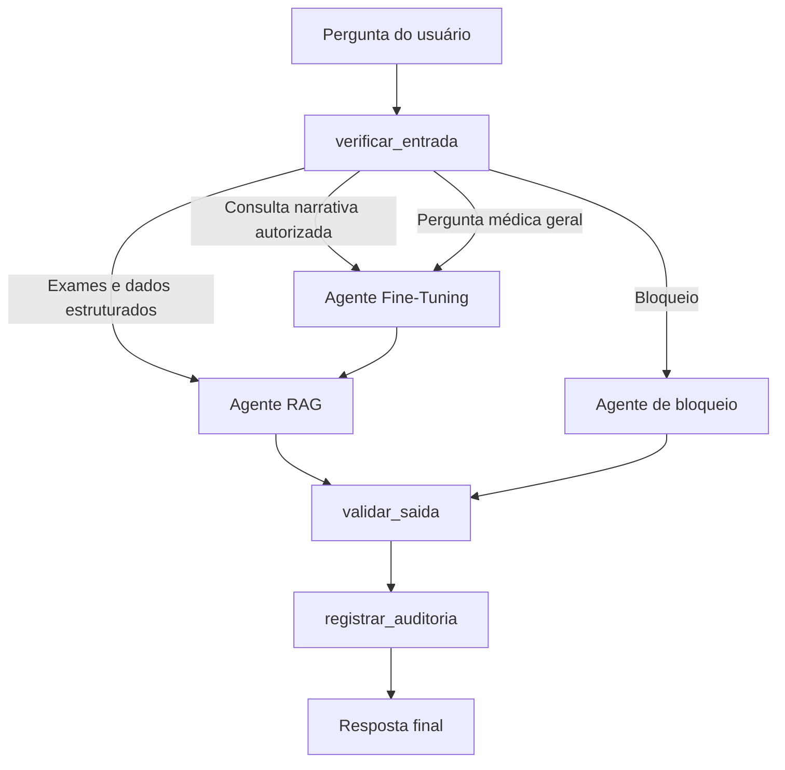

# Relatório Técnico — Tech Challenge Fase 3

## 1. Introdução

Este projeto apresenta o desenvolvimento de um protótipo acadêmico de assistente virtual médico, utilizando técnicas de Fine-Tuning de modelos de linguagem, Retrieval-Augmented Generation (RAG) e orquestração de agentes com LangGraph.

O objetivo é demonstrar como um modelo de linguagem personalizado pode ser integrado a informações de prontuários hospitalares, permitindo responder perguntas médicas gerais e consultar registros clínicos contextualizados.

O sistema utiliza dados públicos de perguntas e respostas médicas e prontuários inteiramente sintéticos. Sua finalidade é exclusivamente educacional, não sendo adequado para decisões clínicas reais.

## 2. Dataset e preparação dos dados

### 2.1. Dataset MedQuAD

Para o Fine-Tuning, foi utilizado o **MedQuAD**, um conjunto público de perguntas e respostas relacionadas à saúde.

Os dados passaram por etapas de extração, normalização, remoção de duplicatas, formatação e separação entre treinamento, validação e teste.

O conjunto de teste foi reservado para avaliação independente, sem participação no treinamento.

Para o treinamento ampliado, foram selecionados exemplos que respeitavam o limite máximo de 512 tokens, evitando truncamentos que poderiam comprometer as respostas.

Os conjuntos elegíveis resultaram em:

| Conjunto    | Exemplos |
| ----------- | -------: |
| Treinamento |   11.391 |
| Validação |    1.439 |

### 2.2. Dados sintéticos hospitalares

Para demonstrar o agente de consulta aos prontuários, foram gerados **1.000 pacientes sintéticos**, contendo dados cadastrais, observações clínicas e exames fictícios.

Cada paciente possui um identificador interno, como `PAC-DEMO-001`, utilizado para recuperar os documentos correspondentes.

Os dados foram organizados em **3.000 documentos** no ChromaDB, distribuídos entre cadastros, anotações clínicas e exames.

Os registros são fictícios e não representam pacientes reais.

## 3. Processo de Fine-Tuning

### 3.1. Modelo utilizado

O modelo selecionado foi o **Qwen2.5-0.5B-Instruct**, disponibilizado pela Hugging Face.

Optou-se pelo **Full Fine-Tuning**, no qual os pesos treináveis do modelo são atualizados. Diferentemente do LoRA, não foram utilizados apenas adaptadores de baixa dimensão.

### 3.2. Preparação para treinamento

Os exemplos foram convertidos para o formato de conversação esperado pelo modelo. A tokenização incluiu máscaras para restringir o cálculo da perda aos tokens apropriados da resposta.

Foi realizado inicialmente um experimento reduzido, utilizado para verificar o funcionamento do pipeline. Posteriormente, iniciou-se o treinamento ampliado a partir dos pesos originais do Qwen.

### 3.3. Configuração do experimento principal

| Parâmetro                          | Configuração                |
| ----------------------------------- | ----------------------------- |
| Modelo                              | Qwen2.5-0.5B-Instruct         |
| Técnica                            | Full Fine-Tuning              |
| Épocas                             | 1                             |
| Taxa de aprendizado                 | 2e-5                          |
| Batch size por dispositivo          | 1                             |
| Acumulação de gradientes          | 8                             |
| Otimizador                          | AdamW                         |
| Precisão dos pesos carregados      | FP32                          |
| Precisão mista durante treinamento | FP16                          |
| Gradient checkpointing              | Habilitado                    |
| Ambiente de treinamento             | Google Colab com GPU Tesla T4 |

Os pesos completos e o tokenizer foram salvos ao término do treinamento e exportados para posterior utilização em inferência.

## 4. Resultados do treinamento

O treinamento ampliado foi concluído após aproximadamente **1 hora e 2 minutos**, totalizando 1.424 etapas de otimização.

| Métrica               |         Resultado |
| ---------------------- | ----------------: |
| Tempo de treinamento   | 3.735,32 segundos |
| Train loss final       |           1,28149 |
| Eval loss final        |           1,21580 |
| Épocas concluídas    |                 1 |
| Etapas de otimização |             1.424 |

A execução demonstrou que o pipeline de treinamento completo conseguiu processar os exemplos elegíveis e salvar os pesos ajustados.

Entretanto, valores de loss não representam diretamente acurácia médica ou taxa de respostas corretas. Uma avaliação clínica sistemática exigiria métricas adicionais e revisão especializada.

## 5. Arquitetura do assistente médico

O assistente foi desenvolvido com dois percursos principais para consultas a pacientes, coordenados pelo **LangGraph**: **RAG direto** e **Fine-Tuning seguido de RAG**. Perguntas médicas gerais e solicitações bloqueadas possuem tratamentos específicos.

### 5.1. Agente de Fine-Tuning

O primeiro agente utiliza o Qwen ajustado com MedQuAD. Para perguntas médicas gerais, gera uma resposta sem consultar prontuários; embora a execução passe pelo nó RAG, não há recuperação de documentos de pacientes.

Para consultas narrativas a pacientes autorizados, o Fine-Tuning é executado antes do agente RAG e produz um rascunho auxiliar. Esse rascunho não substitui as informações recuperadas do prontuário e não é considerado evidência clínica.

As respostas geradas por modelo de linguagem são sinalizadas como não validadas clinicamente.

### 5.2. Agente RAG

O segundo agente responde perguntas relacionadas aos prontuários sintéticos.

Os registros são armazenados no ChromaDB utilizando embeddings produzidos pelo modelo `paraphrase-multilingual-MiniLM-L12-v2`.

A integração com LangChain permite recuperar documentos por identificador e realizar busca semântica nas observações clínicas.

Para perguntas sobre exames, o assistente retorna os registros estruturados do paciente autorizado, sem geração pela LLM. Para perguntas sobre sintomas e observações clínicas, recupera as notas correspondentes e transcreve seus trechos diretamente, preservando os termos registrados.

Outras perguntas narrativas podem utilizar o Qwen original para formular respostas a partir do contexto recuperado, com indicação de que a geração não foi clinicamente validada. O modelo original do RAG é diferente do Qwen ajustado pelo Fine-Tuning.

### 5.3. Identificação dos pacientes

O usuário pode consultar um paciente pelo identificador ou pelo nome completo.

Quando o nome é utilizado, o sistema tenta identificar o registro correspondente e resolver seu ID interno.

Em situações de nomes duplicados, o assistente solicita informações adicionais, como idade ou identificador do prontuário, evitando selecionar arbitrariamente um paciente.

### 5.4. Orquestração com LangGraph

O LangGraph seleciona o caminho conforme a pergunta, a identificação do paciente e a autorização demonstrativa:

- **RAG direto (`rag`):** consultas estruturadas, como exames pendentes, vão diretamente ao agente RAG.
- **Fine-Tuning → RAG (`fine_tuning_rag`):** consultas narrativas sobre pacientes autorizados passam primeiro pelo modelo ajustado e depois pelo RAG. Na consulta de sintomas validada, a resposta final transcreve a nota recuperada e não utiliza o rascunho como fonte de informação.
- **Pergunta médica geral (`fine_tuning`):** utiliza o modelo ajustado; o nó RAG é percorrido sem consultar prontuários.
- **Bloqueio (`bloqueio`):** pedidos proibidos, identificação insuficiente ou acesso não autorizado são interrompidos antes de acessar os agentes de consulta.

A autorização é verificada na entrada, antes do acesso aos registros do paciente. Após o agente executado, a resposta passa pela validação de saída e pelo nó de auditoria.

## 6. Segurança e auditoria

Foram implementados mecanismos demonstrativos para restringir consultas e registrar atividades.

O sistema verifica a autorização fictícia do profissional antes de consultar o prontuário no ChromaDB.

Também foram implementadas regras para bloquear pedidos diretos de prescrição, dosagem ou diagnóstico autônomo.

Os logs registram informações técnicas, incluindo identificador da requisição, data, rota selecionada, status e nós executados, sem armazenar o conteúdo das perguntas ou respostas clínicas.

Esses controles são simplificados. Não representam autenticação hospitalar real, validação profissional nem garantias completas de proteção contra solicitações inadequadas.

## 7. Avaliação funcional do assistente

A integração foi avaliada na célula 55 do Google Colab, com **oito cenários funcionais**:

| Cenário | Resultado observado |
| --- | --- |
| Consulta de exames pelo ID (`rag`) | Recuperação exata do hemograma pendente |
| Consulta de exames pelo nome e idade (`rag`) | Prontuário autorizado identificado corretamente |
| Consulta de sintomas (`fine_tuning_rag`) | Fine-Tuning → RAG; transcrição de “cefaleia e tontura” |
| Identificação de nome duplicado | Bloqueio por ambiguidade |
| Paciente não identificado | Bloqueio por identificação insuficiente |
| Acesso não autorizado | Bloqueio antes da recuperação |
| Solicitação direta de prescrição | Bloqueio da solicitação |
| Pergunta médica geral (`fine_tuning`) | Modelo ajustado executado, sem recuperação de prontuário |

A auditoria confirmou **oito registros** em `auditoria_langgraph.jsonl` para essa validação.

Na consulta por exames, o sistema retornou `EX-0001-01: Hemograma | Status: PENDENTE` para o paciente fictício `PAC-DEMO-001`.

Na consulta de sintomas, o caminho registrado foi `verificar_entrada → agente_fine_tuning → agente_rag → validar_saida → registrar_auditoria`, com status `recuperacao_textual`. A resposta preservou a observação sintética: “Paciente relata episódios de cefaleia e tontura.”

Esses resultados confirmam o comportamento dos cenários funcionais testados, mas não demonstram acurácia clínica ou qualidade geral das respostas do modelo.

## 8. Análise crítica das respostas

Durante os testes do modelo ajustado, foi observada a capacidade de produzir respostas médicas em linguagem natural, especialmente em inglês, idioma predominante nos exemplos utilizados no treinamento.

Entretanto, em uma resposta sobre diabetes mellitus, o modelo apresentou uma associação conceitualmente incorreta entre diabetes e síndrome metabólica.

Também foram observadas respostas interrompidas pelo limite de tokens configurado para inferência.

Em um teste anterior de sintomas, a resposta gerada alterou incorretamente a palavra “cefaleia”. Para esse tipo de consulta, a implementação passou a transcrever diretamente a observação recuperada do prontuário sintético. A nova execução confirmou a preservação de “cefaleia e tontura”. Trata-se de uma mitigação localizada, não de uma validação clínica do modelo.

Esses resultados indicam que a execução bem-sucedida do Fine-Tuning e a recuperação de documentos não garantem, isoladamente, precisão factual ou completude das respostas.

O protótipo precisa de avaliação adicional com perguntas de teste independentes, critérios objetivos de qualidade e revisão de profissionais habilitados antes de qualquer aplicação médica real.

## 9. Limitações do projeto

As principais limitações identificadas foram:

- O Fine-Tuning utilizou o dataset público MedQuAD, e não documentos hospitalares internos.
- Os prontuários são inteiramente sintéticos.
- As permissões de acesso são simuladas.
- O reconhecimento de intenções e os guardrails utilizam regras baseadas em padrões textuais.
- O modelo pode produzir informações incorretas, imprecisas ou incompletas.
- Nas respostas por transcrição, a execução do Fine-Tuning antes do RAG demonstra o percurso dos agentes, mas o rascunho não contribui com informações clínicas para o texto final.
- A transcrição preserva o texto da nota sintética, mas não verifica sua veracidade clínica.
- Não foi realizada validação clínica sistemática.
- A execução exige configurar dependências, reconstruir o índice vetorial e disponibilizar os pesos do modelo ajustado.

Essas limitações devem ser consideradas na interpretação dos resultados.

## 10. Conclusão

O Tech Challenge demonstrou a implementação de um protótipo de assistente médico que integra Full Fine-Tuning, RAG e LangGraph.

O Qwen2.5-0.5B-Instruct foi ajustado com o MedQuAD e integrado ao LangGraph para perguntas médicas gerais e para a etapa inicial de consultas narrativas, seguida pelo agente RAG.

O agente RAG permite consultar informações de 1.000 pacientes sintéticos indexadas no ChromaDB, com consultas estruturadas diretas e recuperação de observações clínicas.

Os oito testes funcionais confirmaram os dois percursos principais, a recuperação de informações, o tratamento de nomes ambíguos, os bloqueios demonstrativos e o registro de auditoria. A correção da resposta de sintomas preservou o texto original recuperado, sem comprovar a precisão clínica do modelo.

Como evolução futura, seriam necessárias validações clínicas abrangentes, autenticação real, controles de segurança mais robustos e estudos adicionais sobre a qualidade das respostas geradas.

O projeto atende ao objetivo de demonstrar tecnicamente a integração dessas tecnologias em um ambiente acadêmico controlado.
